### Hi there, I'm TSK2

A developer who builds things, studies, and occasionally chats about it all.

- Major: Software · Double Major: Data Science
- Blog: [ts2k.tistory.com](https://ts2k.tistory.com) · [tsk2.github.io](https://tsk2.github.io)
- Interests: Security · Machine Learning / Deep Learning · iOS / macOS Apps · Web

#### Data Science

- Training machine learning & deep learning models
- Training large models, including LLMs
- Data preprocessing & normalization
- Big data processing & analysis
- Tools: PyTorch · TensorFlow · Hugging Face

#### Projects

| | |
|---|---|
| **[RAMBar](https://github.com/TSK2/RAMBar)** | macOS menu-bar RAM monitor — memory pressure dot + usage %, quit memory-hungry apps in one click · Swift / AppKit · [Download](https://github.com/TSK2/RAMBar/releases/latest) |
| **HoneyGuard** | Multi-cloud honeypot with AI-based auto-blocking dashboard (capstone project, in progress) |
| **PokeKkang** | 3D tilt holographic card-pack iOS app (in development) |

  
  

Cards are refreshed daily by GitHub Actions · <a href="https://github.com/stats-organization/github-readme-stats-action">github-readme-stats-action</a> (MIT)
